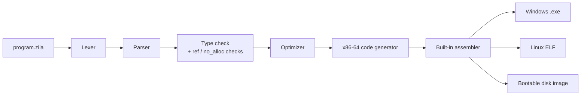

<p align="center"></p>

# Zila Lang

**Version 0.1.0** · [Changelog](CHANGELOG.md)

**A small, readable language that compiles straight to machine code.**

Zila Lang is a compiled, statically typed language with readable syntax, where blocks close with the word end. Its compiler, written in Rust with no dependencies, produces x86-64 programs for Windows and Linux itself: no virtual machine, no garbage collector, no runtime to install. Errors are values, memory is reference-counted, and the same language writes applications, C bindings and a kernel.

**What it is for:** a modern language without the overhead: static types, generics, interfaces, errors as values, async and threads, simple to learn and compiled straight to machine code. It was born to work with AI (as a client of models, tools, MCP and RAG, and as the language that serves them), with native connections to PostgreSQL and SQL Server, and made for the web. IoT and mobile are targets, not yet built. It is extensible through packages and open source.

## Designed with AI, directed by humans, and in need of volunteers

Zila Lang is **being designed with the help of AI, under detailed human direction**: people decide what the language is and why, write the rules it follows ([principles](GOVERNANCE.md#design-principles), a written proposal and a spec with testable scenarios for every change), and review what comes out; AI does a large share of the typing, the drafting and the checking. That is how a compiler, a standard library, a package manager and a small operating system exist after only a few days of work, and it is also why you should read it with a critical eye.

Speed is not the same as maturity. The project is **pre-alpha**: over 1,000 automated tests pass, but almost nothing has been used in anger. **What it needs most now is people**, to refine and extend the language, and above all to **test it and use it in practice**:

- **Write real programs** in it and tell us where it was clumsy, confusing or wrong.
- **Try the examples and the libraries** (`web`, `json`, the databases, `ai`) on your own machine, especially on Linux, where the project is least tested.
- **Report bugs** with the smallest program that shows them, and **question design decisions** in an issue: the principles are the tie-breakers, but nothing is settled until it has met users.
- Improve the documentation, add examples and tests, or take one of the [open gaps](#where-zila-lang-is-going).

See [CONTRIBUTING.md](CONTRIBUTING.md) to start; you do not need to know compilers.

---

## A taste

```zila
package main

type Shape = enum
    Circle(int)
    Rect(int, int)
end

func area(s: Shape) -> int
    match s
        Circle(r)  -> return 3 * r * r
        Rect(w, h) -> return w * h
    end
    return 0
end

func parse(s: text) -> int or error
    if s == "bad"
        return error("cannot parse '{s}'")
    end
    return s.len
end

async func double(n: int) -> int
    await sleep(100)
    return n * 2
end

func main() -> error
    print("areas: {area(Circle(2))} and {area(Rect(3, 4))}")
    let n = try parse("zila")
    let a = double(n)
    let b = double(n + 1)
    print("doubled in parallel: {await a} and {await b}")
    match parse("bad")
        ok(v)  -> print("parsed {v}")
        err(e) -> print("failed: {e.message}")
    end
    return
end
```

```text
$ zila demo.zila -o demo.exe
$ ./demo.exe
areas: 12 and 12
doubled in parallel: 10 and 12
failed: cannot parse 'bad'
```

`match` must cover every case of an `enum`; `try` hands a failure to the caller; the two `double` calls run at the same time (about 100 ms, not 200); and `await` never blocks the other tasks.

## Principles

- **Readable first.** Blocks end with `end`. No braces, no semicolons.
- **Honest about failure.** No exceptions: a function that can fail says so in its type (`T or error`), and `try` is the one visible place where a failure travels up.
- **Honest about cost.** Memory is freed by reference counting the moment the last reference goes away, `unsafe` must be written, and allocation happens only in known operations. `#[no_alloc]` is proved by the compiler and `#[allocator]` replaces the allocator (the kernel's heap is written that way).
- **One language from app to metal.** The same syntax writes an everyday program, a native window, a C binding and a kernel.
- **A toolchain you can read.** Lexer, parser, code generator, assembler and standard library are in this repository.
- **Built in the open.** Every change has a written proposal, a spec and tests ([GOVERNANCE.md](GOVERNANCE.md)).

Diagrams of the pipeline, errors, memory, concurrency and compile-time code generation are in [docs/diagrams.md](docs/diagrams.md), and the whole language is on the [documentation site](docs/index.html).



## What it can do today

- **Native compiler** for Windows (the compiler writes the `.exe` itself) and static **Linux** ELF (`--target linux`); a hello-world is about 6 KB. See [docs/native.html](docs/native.html).
- **Memory model**: reference counting with copy on write, `drop`, `Weak<T>`, `live_objects()` to test for leaks.
- **Types**: records, enums with data, exhaustive `match`, optionals, closures, generics, interfaces, `Map`, sets, sorted collections, `float`, `char` and text.
- **Errors** with kinds, messages and causes (`use errors`), `defer`, `abort`.
- **Concurrency**: lightweight tasks, channels, `async`/`await`, timers, files, TCP, UDP, DNS and TLS on one scheduler written in Zila Lang; OS threads with `shared` and `sync.Mutex` (Windows).
- **Compile-time code generation** (`comptime`, `#[derive]`) and raw `asm`, C interop with `extern`.
- **Libraries** written in Zila Lang: `text`, `list`, `format`, `fs` (files and standard input), `net`, `tls`, `crypto`, and the packages in [`packages/`](packages): `json`, `web` (`use web`), an HTTP server and client, `ai`, `mcp`, `rag`, `db`, `postgres`, `sqlserver` (see [docs/databases.html](docs/databases.html), with `sql` blocks) and `ui` (native windows on Windows, drawn over X11 on Linux).
- **Interactive and inline**: `zila repl` is a prompt where entries build on each other (each entry re-runs the session, so side effects repeat), `zila -e` runs code given on the command line, `zila run -` reads a program from a pipe.
- **Tooling**: `--fmt`, `--test`, a package manager (`zila.toml`, `zila.lock`), a language server and a VS Code extension.
- **Zila Lang OS**: a bootable 64-bit operating system whose boot sector and kernel are written in Zila Lang (18 KB, boots in QEMU). See [docs/os.html](docs/os.html).
- **More than 1,000 automated tests**, and a documentation site that tests keep in step with the code.

## Where Zila Lang is going

Every language change is an [OpenSpec](openspec) change: open ones live in `openspec/changes/`, finished ones in `openspec/changes/archive/`, and their result is the living specification in `openspec/specs/`. **Two changes are built and waiting for a manual check on a real terminal:** `add-repl` (the interactive `zila repl`) and `fix-console-input-encoding` (UTF-8 for text typed at a Windows console). A test keeps this section from naming a change that is not open.

**Known gaps** (each is a place where you can help):

| Area | What is missing |
|---|---|
| Compiler structure | Emission still walks the syntax tree instead of a typed tree, and there is no cache of checked packages (incremental builds). |
| Threads | The Linux thread layer, weak references on `shared T`, a work-stealing scheduler, a thread pool, condition variables. |
| TLS | Server side, `close_notify`, a buffered reader. |
| Language server | Hover, go to definition, completion and type errors. |
| VS Code extension | Packaging the `.vsix` and the manual smoke test. |
| Windows/Linux parity | The differences in `tests/data/std_parity_known.txt`; the list may only shrink. |
| New targets | macOS, ARM64 (Apple Silicon, Android, iOS), WebAssembly. Not specified yet. |
| More libraries | Oracle, MySQL and SQLite as packages. |
| Self-hosting | A Zila Lang compiler written in Zila Lang. |

Not covered by `web` yet: HTTP/2, WebSocket, TLS on the server side, cookies, multipart, streaming bodies. No registry or signing in the package manager.

### How a change happens

1. **Propose it** in an issue: what, why, alternatives. Small fixes can go straight to a pull request.
2. **Discuss and decide**; a maintainer records the decision with the reason.
3. **Specify it** as an OpenSpec change (proposal, spec with testable scenarios, design, tasks).
4. **Build it** with tests and documentation updates.
5. **Archive it**: the spec joins `openspec/specs/`.

## Getting started

You need a recent **Rust** toolchain (<https://rustup.rs>); on Windows, Rust's MSVC toolchain needs the Visual Studio C++ linker to build the compiler (Zila Lang programs themselves need nothing). QEMU is optional, to boot Zila Lang OS.

```sh
git clone https://github.com/code4performance/zila
cd zila
cargo build --release          # the tool is target/release/zila
```

```sh
zila program.zila -o program.exe              # compile to a native Windows executable
zila program.zila --target linux -o program   # compile to a static Linux ELF
zila run program.zila                         # compile, run, delete (same as --run)
zila repl                                     # an interactive session (also: zila -i)
zila -e 'print(1 + 2)'                        # run code given right here, no file
zila eval - <<'EOF'                           # ...or from a pipe or here-document
print("hi")
EOF
zila --fmt file.zila                          # format in the standard style
zila --test file.zila                         # run the #[test] functions
zila --os os/boot.zila os/kernel.zila -o zila-os.img   # bootable disk image
```

Run `zila` with no arguments for every option. Try `examples/hello.zila` and `examples/async.zila`, run `cargo test` (tests that need Windows, WSL, QEMU or a database skip themselves), and open [`docs/index.html`](docs/index.html) for the documentation (a static site). The VS Code extension is in [`editors/vscode`](editors/vscode): put `zila` on your `PATH`, then `npx @vscode/vsce package` and install the `.vsix`.

## What is in the repository

```text
src/          the compiler in Rust: lexer, parser, native code generator, assembler, PE writer,
              optimizer, formatter, test runner, language server, comptime, package manager
std/          the core of the standard library, written in Zila Lang
packages/     the other libraries, as packages: json, crypto, tls, ui, web, ai, mcp, rag, db, postgres, sqlserver
os/           Zila Lang OS: boot sector and kernel
examples/     example programs
docs/         the documentation site, the grammar (zila.ebnf), the C interop spec (zila-ffi.md), diagrams
editors/      VS Code extension and GitHub language definition
openspec/     proposals, specs and design notes for every language change
tests/        compiler, library, OS and documentation tests
tools/        helper scripts
```

## Join in

Zila Lang is at the stage where **one contribution can shape the language**, and where **using it is worth more than reading it**. A clear bug report, a program that did not work, a new example or a better error message all count.

1. Read [CONTRIBUTING.md](CONTRIBUTING.md) for the practical steps and [GOVERNANCE.md](GOVERNANCE.md) for the rules and how decisions are made.
2. Everyone follows the [Code of Conduct](CODE_OF_CONDUCT.md).
3. Pick a gap above, or open an issue and tell us what you would like to build or test.

Everything happens on GitHub: [issues](https://github.com/code4performance/zila/issues) for bugs and proposals, [pull requests](https://github.com/code4performance/zila/pulls) for code.

### License

The project is intended to be dual-licensed under **MIT** or **Apache-2.0**, at your choice, and contributions are accepted under the same terms (see [GOVERNANCE.md](GOVERNANCE.md#licensing)). Programs you write *in* Zila Lang belong entirely to you.

---

*If you believe a programming language can be simple, honest and close to the machine at the same time, help us find out, by using it.*
