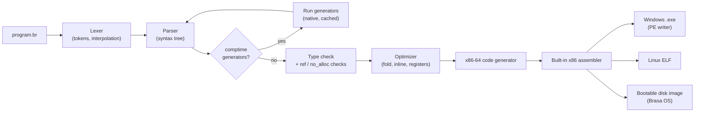
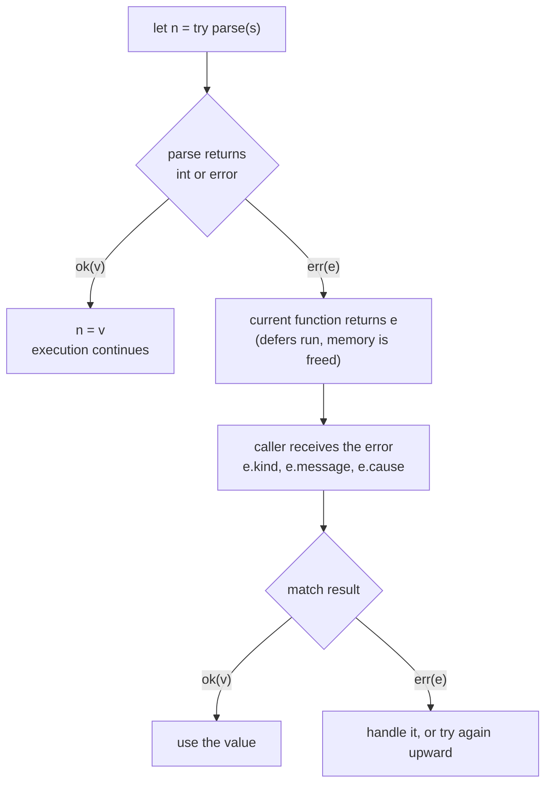
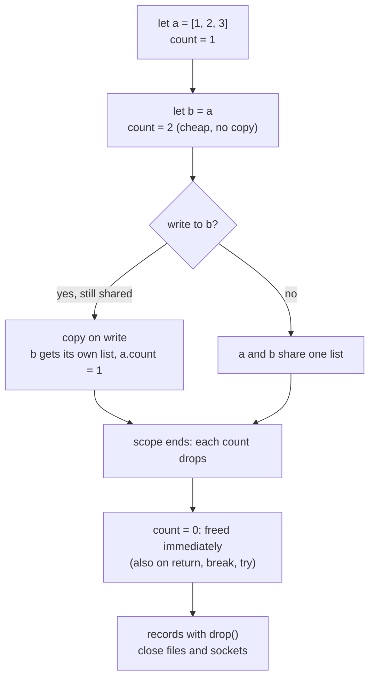
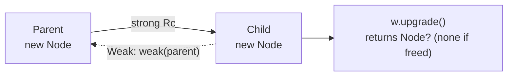
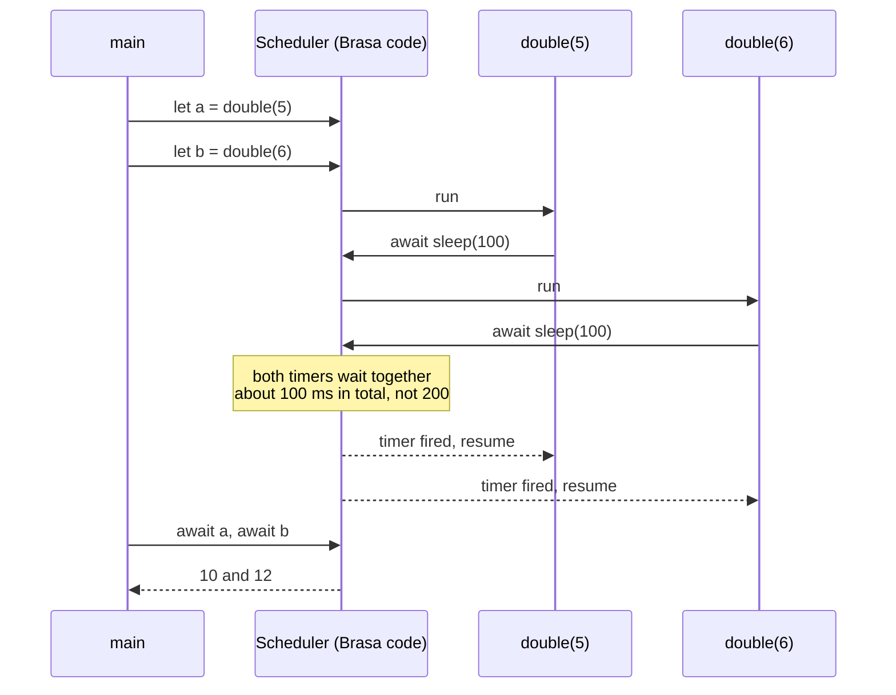
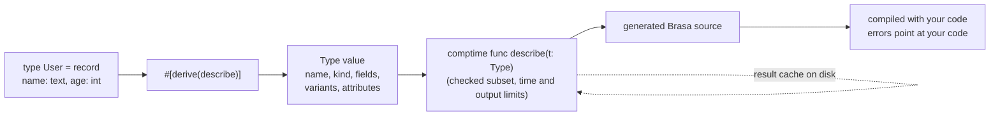
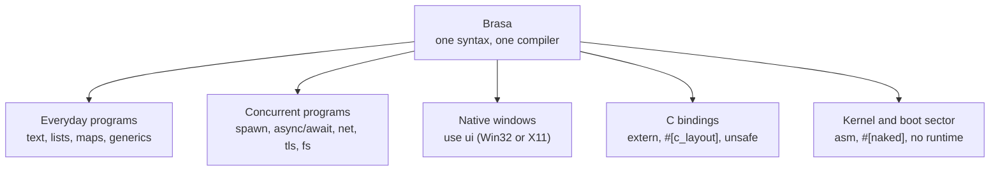

# 🔥 Brasa

> **A compiled, statically-typed systems programming language that feels like Go, thinks like Rust, and talks to C without ceremony.**

Brasa compiles straight to x86-64 machine code. No LLVM, no virtual machine, no garbage collector, and no runtime to install. The compiler is written from scratch in Rust with **zero dependencies**, it ships with its own x86 assembler, and the same toolchain that builds a 6 KB Windows program also builds a bootable 64-bit operating system.

It is young, it is honest about what it can't do yet, and it is looking for people to help it grow. **If you like compilers, language design, or just want to see what a clean-slate language looks like, come build it with us.**

### The name

*Brasa* is the Portuguese word for **ember** — a glowing coal that burns hot, long, and clean, without the noise of an open flame. That is exactly what this language aims to be: intense power, controlled heat, no waste.

The name hides two deliberate puns, both rooted in its Brazilian origin:

- **Brasa → Brasil.** The first five letters of *Brasil* are *Brasa*. This is a systems language born in Brazil 🇧🇷, and the name wears that proudly.
- **"Vamos mandar brasa!"** In Brazilian Portuguese, *mandar brasa* literally means *to send embers* — but as slang it means ***"Let's do it! Let's go all out!"*** That is the spirit behind the language: get things done, full power, no excuses.

> **Brasa** = *ember* (PT) · *Bras**a** → Bras**il*** · *"Vamos mandar brasa!"* = Let's do it! 🚀

---

## Why Brasa?

Most languages ask you to choose: simple *or* fast, safe *or* low-level, friendly *or* close to the machine. Brasa's goal is to make that choice smaller.

- **Readable first.** Blocks end with `end`. No braces, no semicolons. A beginner can read a program top to bottom.
- **Honest about failure.** There are no exceptions. A function that can fail says so in its type (`T or error`), and `try` is the one visible place where a failure travels up.
- **Honest about cost.** Memory is freed by reference counting, the moment the last reference goes away. Unsafe code must say `unsafe`. Allocation only happens in known operations (text interpolation, list and map literals, closures that capture, `spawn`, `new`). Two guarantees are built: `#[no_alloc]`, where the compiler proves a function allocates nothing (the allocating operations are a fixed list, and the standard library is checked like your own code), and `#[allocator]`, to replace the allocator on every target (the kernel's heap is written that way). See [what is planned](#how-brasa-will-evolve).
- **One language from app to metal.** The same syntax writes an everyday program, a native window, a C library binding, and a kernel.
- **A toolchain you can read.** Lexer, parser, code generator, assembler, standard library: all in this repository, all small enough to understand.
- **Built in the open.** Every language change goes through a written proposal, a spec with testable scenarios, and tests. See [GOVERNANCE.md](GOVERNANCE.md).

---

## A taste of Brasa

```brasa
package main

type Shape = enum
    Circle(int)
    Rect(int, int)
end

func area(s: Shape) -> int
    match s
        Circle(r)  -> return 3 * r * r
        Rect(w, h) -> return w * h
    end
    return 0
end

func parse(s: text) -> int or error
    if s == "bad"
        return error("cannot parse '{s}'")
    end
    return s.len
end

async func double(n: int) -> int
    await sleep(100)
    return n * 2
end

func main() -> error
    print("areas: {area(Circle(2))} and {area(Rect(3, 4))}")
    let n = try parse("brasa")
    let a = double(n)
    let b = double(n + 1)
    print("doubled in parallel: {await a} and {await b}")
    match parse("bad")
        ok(v)  -> print("parsed {v}")
        err(e) -> print("failed: {e.message}")
    end
    return
end
```

```text
$ brasa-parse demo.br -o demo.exe
$ ./demo.exe
areas: 12 and 12
doubled in parallel: 10 and 12
failed: cannot parse 'bad'
```

A few things to notice: `match` must cover every case of an `enum`; `try` hands a failure to the caller; the two `double` calls run at the same time, so the program waits about 100 ms, not 200; and `await` never blocks the other tasks (it works in any function, not only `async` ones).

---

## The language in pictures

Five diagrams that explain how Brasa works. (GitHub draws them for you.)

### 1. From source to machine code

There is no LLVM, no linker and no virtual machine in the middle: the compiler writes the executable itself.



### 2. Errors are values

A function that can fail says so in its type. `try` is the one visible place where a failure travels up.



### 3. Memory without a garbage collector

Values are reference counted and freed the instant the last reference goes away. Writes copy first when a value is shared.





A cycle made only of strong `Rc` references is not collected; break it with `Weak`.

### 4. Concurrency: tasks on one scheduler

Tasks are lightweight and cooperative. `await` hands the thread to another task instead of blocking it.



### 5. Compile-time code generation

A `comptime func` is a native program that reads a type and writes Brasa source, which the compiler compiles in place.



### One language, from app to metal



---

## What Brasa can do today

Everything in this list is implemented and covered by tests.

**A real native compiler**

- Compiles to x86-64 machine code for Windows. A hello-world is about **6 KB**; a native window with a text box, a button and a list is about **50 KB**.
- Compiles to a **static Linux x86-64 ELF** too (`--target linux`), with the same language, the same libraries and the same output. No linker, no C library; a program that calls C becomes a dynamic executable. See [docs/native.html](docs/native.html#linux).
- Needs no runtime on the target machine. The programs import only the operating-system libraries they use.
- Writes the Windows `.exe` itself, with its own assembler and PE writer: building needs no Visual Studio, `ml64` or `link`, just like the Linux ELF path.

**A predictable memory model**

- Reference counting frees every heap value as soon as it is unreachable, including on early `return`, `break` and `try`. There are no GC pauses.
- Records, lists and maps have value semantics: assigning or passing one is cheap (reference counted), and writing to a list or map that another holder still has copies it first (copy on write). `ref` shares the caller's value; to fill a caller's list, take it as `ref xs: []int` and call `fill(ref xs)`. Records can define `drop` to close files and sockets automatically.
- `live_objects()` reports how many heap objects are alive, so leaks are easy to test for. The test suite uses it to check that thousands of tasks and connections leave nothing behind.
- `new Node{ ... }` makes a shared, reference-counted object (`Rc<Node>`); `Weak<T>` with `weak(x)` and `w.upgrade()` holds one without keeping it alive, so trees with parent links, observers and graphs are freed completely. A cycle made only of `Rc` references is still not collected: break it with `Weak`. See `examples/tree.br`.
- `use text`, `use list`, `use format`, `use set` and `use sorted`: `split`, `join`, `trim`, `replace`, `parse_int`, `parse_float`, `map`, `filter`, `reduce`, `sort_by`, `sort`, `contains` and more, written in Brasa on top of generics.
- Generics and interfaces: `func first<T>(items: []T) -> T`, `type Stack<T>`, and `T: Printable` bounds with structural interfaces. The compiler infers the type arguments (or you write them: `empty<int>()`) and makes one copy per type used.
- **Compile-time code generation**: a `comptime func` receives a `Type` (name, kind, fields, variants, attributes) and returns Brasa source that the compiler compiles in place. `#[derive(name)]` adds methods to a type, `#[generated(gen)]` writes the body of a function for each type it is called with, and `#[block]` gives a library its own block syntax (a name, raw lines, `end`). Generators are native programs built and run for the build machine, limited to a checked, deterministic subset of the language (no I/O, `spawn`, `unsafe`, `asm` or global variables), with a time and output limit, hygiene for generated names, errors that point at your code, and an on-disk cache. See [docs/syntax.html](docs/syntax.html#comptime) and `examples/comptime.br`.
- `float` (`f64`) and `f32`: arithmetic, comparisons that follow IEEE 754, explicit `float(n)` / `int(x)` conversions, shortest-text printing, `use math`, and C calls through the XMM registers.
- `Map<K, V>` stores values under any key type that is `Hash` (text, integers, records, enums, lists): `{ "a": 1 }` literals, `m[key]`, `has`, `get(key, default)`, `remove`, and `for key, value in m` in insertion order.
- `Eq`, `Ord` and `Hash` are standard interfaces (no `use`) that the compiler derives for records and enums and you can override with `eq`, `compare` and `hash` methods; `==`, `<` and the other comparison operators work on such types and on a bounded `T: Ord`, and `Self` names the satisfying type inside an interface.
- `defer call(...)` runs a call when the function ends, however it ends (`return`, the end of the body, or a failed `try`), last in first out.

**Types that help**

- Records, enums that carry data, exhaustive `match`, optionals (`T?`, `??`, `?.`), closures, methods, default and named arguments.
- Errors as values with `T or error`, `try`, and `match` on `ok(...)` / `err(...)`. An error has a kind (`e.kind == errors.NotFound`, open and namespaced, `use errors`), a message and a cause: `error(kind, "message", cause)`, `e.context("message")`, `e.is(kind)`, `e.full_message`.

**Concurrency without ceremony**

- Lightweight tasks (`spawn`) and channels, plus `async` / `await` with futures.
- Timers (`sleep`, `timeout`), `await all(...)`, `await race(...)`, file I/O, TCP and UDP networking, asynchronous name lookup and TLS that never block the other tasks, all on one scheduler written in Brasa. The same code runs on Windows and on Linux.
- Measured: 2000 tasks at once, and 100 simultaneous TCP clients, each answered correctly.
- Tasks are cooperative and each thread has its own scheduler. For parallelism, `spawn_thread` starts an operating-system thread (Windows), `shared` makes data that threads may read (atomic reference counts, immutable content), and `sync.Mutex<T>` and `sync.Atomic` change it; the compiler decides what may cross to another thread from the types and names the field that cannot. Programs that use no threads pay nothing.

**A standard library written in Brasa**

- `task`, `future`, `fs`, `net` (TCP, UDP, DNS), `tls` (an HTTPS client: SChannel on Windows, OpenSSL on Linux), `crypto` (SHA-256, HMAC, PBKDF2, base64, random bytes), `ai` (chat, streaming, typed answers and tools for language models; see docs/ai.html), `mcp` (an MCP server and client over stdio and HTTP), `rag` (chunking, vector stores, retrieval and grounded answers), `db`, `postgres` and `sqlserver` (typed rows, bound parameters, transactions, and SQL written in `sql postgres` and `sql tsql` blocks, written in Brasa over `net` and `tls`; see docs/databases.html), `web` (an HTTP/1.1 server with routing and middleware, an HTTP client and HTML templates) and `ui` (windows and controls with one API: native Win32 controls on Windows, controls drawn over the X11 protocol on Linux). On Windows they talk to the operating system through Brasa's own `extern` declarations, on Linux through system calls. No Rust or C glue. Of these, `json`, `crypto`, `tls`, `ui`, `web`, `ai`, `mcp`, `rag`, `db`, `postgres` and `sqlserver` are on their way to being packages of their own (their sources are in [`packages/`](packages), a package of your project may take their name, and using them as part of the standard library prints a warning); the rest is the core, whose names are reserved.

**Systems programming**

- C interop: `extern` functions, callbacks, `#[link("lib")]`, `#[c_layout]`, raw pointers, `unsafe` blocks.
- Inline `asm` with named registers, and `#[naked]` functions.

**Tooling**

- `--fmt` / `--fmt-check`: one standard style, only whitespace changes, comments kept.
- `--test`: runs the `#[test]` functions of a file natively, with `assert` and `assert_eq`.
- `--lsp`: a language server (Language Server Protocol, no dependencies) that reports syntax errors as you type and formats documents.
- A VS Code extension in [`editors/vscode`](editors/vscode): highlighting, syntax errors and Format Document through the language server. No npm dependencies.

**Brasa OS**

- A **bootable 64-bit operating system** with its boot sector and kernel written in Brasa. The whole disk image is **18 KB**. It boots in QEMU, switches the CPU to long mode, and runs a small shell on the keyboard, the screen and the serial port. The compiler assembles the machine code itself; no NASM, no linker. See [docs/os.html](docs/os.html).

**Engineering you can trust**

- About 390 automated tests (some need Windows, WSL or Node and skip themselves without them). The documentation site is checked against the code by tests, so it cannot quietly go stale. Every design decision lives in [`openspec/`](openspec).

---

## Ideas Brasa borrowed

Brasa does not pretend to be new in every way. It takes ideas that proved themselves and tries to combine them with less ceremony.

| From | What Brasa took | How it looks in Brasa |
|---|---|---|
| **Go** | Small language, `package` / `use`, goroutine-style tasks and channels, structural interfaces, one self-contained executable | `spawn worker(ch)`, `channel(int)`, no `implements` keyword |
| **Rust** | Enums with data and exhaustive matching, errors as values, explicit `unsafe`, no tracing garbage collector, a `drop` hook | `match`, `T or error` with `try`, `unsafe ... end`, `func (ref x: T) drop()` |
| **Elixir** | Pattern matching as the main way to take data apart, lightweight tasks, `ok` / `err` results | `ok(v)` / `err(e)` arms, thousands of tasks |
| **Swift** | Reference counting for memory, optionals, string interpolation | `T?`, `??`, `?.`, `"hello {name}"` |
| **C#, JavaScript, Kotlin** | `async` / `await` with futures | `async func`, `await`, `Future<T>` |
| **Ruby, Lua, Pascal** | Blocks closed by `end` | no braces, no semicolons |
| **C and Zig** | A first-class neighbour: C interop, freestanding programs, no hidden runtime | `extern`, `#[c_layout]`, kernels with no operating system |
| **C++** | Operators spelled as words | `bitand`, `bitor`, `bitxor`, `bitnot` |

And a few things that are Brasa's own:
- `or error` / `try`: the shape of Rust's `Result` and `?`, in words a beginner can read.
- The whole async scheduler, the networking, the file I/O and the windowing library are **ordinary Brasa code**, so you can read and change them.
- One compiler that targets both a Windows program and a bare-metal kernel.

---

## Where Brasa stands

Brasa is **pre-alpha**. The design is settling, but breaking changes are still possible before 1.0.

| Area | State |
|---|---|
| Lexer and parser | ✅ Complete for the grammar in [`brasa.ebnf`](brasa.ebnf) |
| Native compiler (Windows x64) | ✅ Works for a large, useful subset. Writes the PE `.exe` itself: no Visual Studio, `ml64` or `link` (the OpenSpec change `add-direct-pe-output` is still open for review) |
| Bare-metal target and Brasa OS | ✅ Boots and runs |
| `async` / `await`, timers, files, TCP, UDP | ✅ Works |
| Floating point | ✅ Works: `float`/`f64`/`f32`, `use math`, C calls, on Windows and Linux |
| Generics and interfaces | ✅ Works: generic functions and records, inferred type arguments, structural interfaces as bounds |
| Maps (`Map<K, V>`) | ✅ Works: any `Hash` key (text, integers, records, enums, lists), insertion order |
| Text, list, format, set and sorted libraries | ✅ `use text`, `use list`, `use format` (`%` templates, padding, hex, thousands, and `format.fmt` for values of any type with `%(08x)`, `%(>10,)` and `%(.2f)`, native only), `use set`, `use sorted` (sorted maps and sets, ordered by `compare` or by a function), `use derive` (`hash_combine`) and `use bufio` (the buffers behind line reading and buffered writing in `fs` and `net`). More to come |
| Text and characters | ✅ A `char` type; `len` counts bytes, `for c in s` walks characters, `slice` cuts by bytes and aborts inside a character, `s.bytes()`, `s.byte(i)`, `s.char_count()`, `text.chars`, `text.from_bytes`; `reverse` and `pad_*` work on characters. **Breaking:** `s[i]` on a text and `chr(n)` are gone (use `s.byte(i)`, `for c in s`, `char(n).to_text()`) |
| Optimizer | 🔧 Constant folding, direct operands, compare-and-branch, peephole cleanups, integer variables in registers and inlining of small functions (`--no-opt` turns them off) |
| Formatter (`--fmt`, `--fmt-check`) | ✅ Standard style for `.br` files; only whitespace changes, comments kept |
| Test runner (`--test`, `#[test]`, `assert`, `assert_eq`) | ✅ Runs the tests of a file natively and reports `ok`/`FAIL` with the line |
| Language server (`--lsp`) | ✅ Syntax errors and formatting. Hover, go to definition, completion and type errors: ⏳ not started |
| VS Code extension | ✅ Highlighting, syntax errors and formatting through the language server (package it with `npx @vscode/vsce package`; the manual smoke test is still open) |
| TLS (`use tls`) | ✅ HTTPS client on Windows (SChannel) and Linux (OpenSSL 3), with certificate and host-name checks. Server side: ⏳ not started |
| Windows and controls (`use ui`) | ✅ One API on both systems: native on Windows, drawn on X11 on Linux |
| Compile-time reflection (`comptime func`, `#[derive]`, `#[generated]`, blocks) | ✅ Works: the `Type` API, derives, type-indexed functions and block syntax, the checked comptime subset, limits, hygiene, source-mapped errors, a result cache and `--comptime-*` options. Libraries that use it: `json` ✅, `web` ✅ |
| JSON (`use json`) | ✅ `json.parse(T, text)` and `json.encode(T, x)` for any record, enum, list, map, optional, number, `bool` and `text` (derived at build time through reflection: no registration, no JSON in the compiler), `#[json("key")]` and `#[json(skip)]`, the dynamic `json.Value` tree, strict RFC 8259, errors with line and column or a `$.path`, pretty printing, a depth limit; Windows and Linux |
| Web (`use web`) | ✅ An HTTP/1.1 server (one task per connection; `Content-Length` and chunked bodies, keep-alive, size limits, scheduler-driven timeouts, `408`/`413`/`414`/`431`/`503`), routes with `:name` and `*rest`, middleware with `app.use`, errors mapped to statuses by kind, `web.read_json(T, req)` and `web.json(T, status, value)` on `use json`, a client (`web.get`, `web.post`, `web.request`, https through `tls`, redirects, limits) and `html ... end` templates that escape every interpolated value. Windows and Linux; rejected in a bare-metal kernel. Not covered: HTTP/2, WebSocket, TLS on the server side, cookies, multipart, streaming bodies |
| Package manager (`brasa.toml`, `brasa.lock`, `--init`, `--add`, `--fetch`, `--tidy`, `--update`) | ✅ Dependencies are git repositories pinned by commit and checked by a SHA-256 tree hash; semver with minimal version selection (no solver); majors coexist as different packages; a cache in `~/.brasa`; a normal build never touches the network or runs `git`; local packages are directories; `use name.path`; only `pub` items cross packages. No registry, publishing or signing |
| Linux x86-64 (`--target linux`) | ✅ ELF written by the compiler (no linker; static unless the program calls C): the language and every library, `ui` included (drawn on an X11 display), with the same output as Windows (tasks, `async`, files, TCP/UDP, DNS, calling C) |
| macOS, ARM64, Android, iOS | ⏳ Not started |

---

## How Brasa will evolve

Every item below is an [OpenSpec](openspec) change that is already written (proposal, spec with testable scenarios, design and task list) and not started, unless it says otherwise. They refer to each other, so the order is decided as each one is applied. **Every item is a place where you can help.**

**Foundations: simpler, more honest basics**

| Change | What it does |
|---|---|
| `add-int-long-aliases` | `int` is `i32` and `long` is `i64`: aliases of the sized types, with lossless widening (`int` goes into a `long`), 32-bit `int` arithmetic, `int` lengths and indices, and `long` for sizes and times. **Breaking.** |
| `add-error-kind` | Errors carry a *kind* (`NotFound`, `PermissionDenied`, ...), a message and a cause, so programs stop comparing text. New `use errors`. **The code is in the working tree**; the change is open until archived. **Breaking.** |
| `remove-panic-add-abort` | `panic` becomes `abort` (there are no exceptions, so the name should not suggest them), integer arithmetic wraps everywhere, and `checked_add` and friends return `int or error`. **Breaking.** |
| `add-visibility-pub` | `pub`: declarations are private by default, so libraries can hide their helpers. **Breaking.** |

**Values, memory and references**

| Change | What it does |
|---|---|
| `add-derived-eq-ord-hash` | `Eq`, `Ord` and `Hash` derived by the compiler for records and enums; `Map` keys can be any hashable type. |
| `add-copy-on-write` | Lists, maps and text buffers get true value semantics (copy on write), so a record really is copied when assigned. **Breaking.** |
| `add-weak-refs` | `new` makes the explicit shared object and `Weak<T>` breaks reference cycles (trees with parent links, observers, graphs). |
| `restrict-ref-escape` | A `ref` can no longer outlive the call that received it; the compiler rejects the use-after-free it used to allow. **Breaking.** |
| `add-no-alloc-and-allocator` | `#[no_alloc]` (proved by the compiler) and a replaceable `#[allocator]`; the kernel moves its heap behind it. |

**Concurrency**

| Change | What it does |
|---|---|
| `remove-async-coloring` | `await` is allowed in any function, so a plain function can call something that waits. Nothing that compiles today stops compiling. |
| `add-threads-and-shared` | Real parallelism: `shared T` with atomic reference counts, `spawn_thread`, thread-safe channels, one cooperative scheduler per thread. |
| *(planned, stage 2)* | A work-stealing scheduler that moves tasks between threads, parallel `async`, a thread pool in the library, condition variables and read-write locks; the Linux thread layer (`clone` and `futex`). |

**Metaprogramming and libraries**

| Change | What it does |
|---|---|
| `add-web` | `use web`: an HTTP/1.1 server with routing, middleware, JSON helpers and error-to-status mapping, an HTTP client and escaping HTML templates, on top of `net`, `tls` and `json`. |
| `add-sql-blocks` | **Built.** `sql postgres` and `sql tsql` blocks hold SQL as raw lines, with every `{value}` sent as a bound parameter and the dialect's lexical mistakes found at compile time. A dialect is a declaration in a package, so Oracle, MySQL and SQLite are planned as new packages (a driver and a declaration) with no compiler change. Dialects are lexical profiles, not SQL parsers. |

**Compiler and tooling**

| Change | What it does |
|---|---|
| `add-direct-pe-output` | The compiler writes the Windows PE itself. **The code is in the working tree** (`src/pe.rs`); the change is open until its tasks are verified and archived. |
| `remove-interpreter` | `--run` compiles a temporary native program and runs it, with the same errors as `--build`; the second implementation of the language is gone. **The code is in the working tree**; the change is open until archived. **Breaking** for the library API. |
| `add-vscode-extension` | **Built and tested**; open for the `.vsix` packaging step and the manual smoke test. |
| `rename-language` | Prepares a one-command rename of the language (a tool, a leftover test and a rehearsal); the new name is not chosen yet. |

**Further out** (not specified yet): TLS for servers; hover, go to definition, completion and type errors in the language server; macOS (a `ui` for it, then the rest); an ARM64 backend for Apple Silicon, Android and iOS; WebAssembly; and a Brasa compiler written in Brasa.

Beyond the compiler, contributions that make a big difference right now:
**more example programs**, **bug reports with a tiny failing program**, **documentation and tutorials**, and **tests**.

### How a change happens

1. **Propose it.** Open an issue describing *what*, *why* and the alternatives. Small fixes can skip straight to a pull request.
2. **Discuss and decide.** The community debates it; a maintainer records the decision (accepted, rejected, or deferred) with the reason.
3. **Specify it.** Accepted language changes become an [OpenSpec](openspec) change: a proposal, a spec with testable scenarios, a design, and a task list.
4. **Build it.** Implementation comes with tests, and with updates to the documentation site.
5. **Archive it.** The spec joins the project's living specification in [`openspec/specs/`](openspec/specs).

The full rules are in [GOVERNANCE.md](GOVERNANCE.md) and [CONTRIBUTING.md](CONTRIBUTING.md).

---

## Getting started

**You need**

- A recent **Rust** toolchain (stable): <https://rustup.rs>
- Nothing else to compile Brasa programs: the compiler writes the Windows executable itself (no Visual Studio). Building the compiler with Rust's default MSVC toolchain on Windows needs the Visual Studio C++ linker, which is Rust's requirement, not Brasa's.
- Optional: **QEMU** to run Brasa OS (`winget install SoftwareFreedomConservancy.QEMU`).

**Build the compiler**

```sh
git clone https://github.com/code4performance/brasa-parser
cd brasa-parser
cargo build --release
```

The tool is called `brasa-parse` (`target/release/brasa-parse`).

**Use it**

```sh
brasa-parse program.br                 # check a program and print a summary
brasa-parse program.br -o program.exe  # compile to a native Windows executable
brasa-parse program.br --target linux -o program   # compile to a static Linux ELF
brasa-parse program.br --run           # compile and run it
brasa-parse program.br --asm           # show the generated assembly
brasa-parse program.br --ast           # show the syntax tree
brasa-parse program.br --tokens        # show the tokens
brasa-parse --os os/boot.br os/kernel.br -o brasa-os.img   # build a bootable disk image
brasa-parse --fmt file.br              # format files in the standard style (--fmt-check only lists them)
brasa-parse --test file.br             # run the #[test] functions of a file
brasa-parse --lsp                      # run the language server on standard input and output
brasa-parse --docs                     # refresh the examples on the documentation site
```

**Try the examples**

```sh
brasa-parse examples/hello.br -o hello.exe && ./hello.exe
brasa-parse examples/async.br -o async.exe && ./async.exe
brasa-parse examples/hello.br --target linux -o hello && ./hello   # on Linux (or WSL)
.\os\run.ps1                            # build and boot Brasa OS in QEMU
```

**Run the tests**

```sh
cargo test
```

Tests that need the Windows toolchain or QEMU skip themselves when those are missing, so the suite is designed to run anywhere Rust does.

**Use it in VS Code.** The extension in [`editors/vscode`](editors/vscode) gives highlighting, syntax errors as you type and Format Document. Put `brasa-parse` on your `PATH`, then `npx @vscode/vsce package` and install the `.vsix`.

**Read the docs.** Open [`docs/index.html`](docs/index.html) in a browser. It is a static site, no server needed.

---

## What is in the repository

```text
src/
  lexer.rs         tokens, newline rules, text interpolation
  parser.rs        recursive-descent parser for brasa.ebnf
  ast.rs           syntax tree
  run.rs           --run: build a temporary executable, run it, delete it
  float_text.rs    reference float layout the tests compare native output with
  codegen_x64.rs   native compiler: type checks, x86-64 code, runtime, Windows and Linux back ends
  asm_x86.rs       the x86 assembler (16, 32 and 64-bit): bare-metal images, Windows and Linux programs
  pe.rs            the Windows PE writer
  regalloc.rs      register allocation for the optimizer
  fmt.rs, testrun.rs, lsp.rs   the formatter, the test runner, the language server
  comptime.rs, comptime/   compile-time code generation: reflection data, subset check, generator driver and cache, expansion
  cli.rs, docs.rs  command-line options; the documentation generator
  package.rs, fetch.rs   the package manager: manifest, lock, versions, hashes, cache and resolver; the git runner and the package commands
std/               standard library, written in Brasa: ui, task, future, fs, net, tls, web, crypto, db, postgres, sqlserver, sys, text, list, format, set, sorted, bufio (and ws, internal to net); `*.linux.br` are the Linux layers
os/                Brasa OS: boot.br (boot sector) and kernel.br
examples/          example programs
docs/              the documentation site (static HTML)
editors/vscode/    VS Code extension: highlighting, syntax errors and formatting through the language server
openspec/          proposals, specs and design notes for every language change
tests/             parser, compiler, async, OS and documentation tests
brasa.ebnf         the formal grammar
brasa-ffi.md       C interop and inline assembly specification
```

---

## Join in

Brasa is at the stage where **one contribution can shape the language**. You don't need to be a compiler expert: a clear bug report, a new example, or a better error message all count.

1. Read [CONTRIBUTING.md](CONTRIBUTING.md) for the practical steps.
2. Read [GOVERNANCE.md](GOVERNANCE.md) for the rules, the design principles, and how decisions are made.
3. Everyone in the project follows the [Code of Conduct](CODE_OF_CONDUCT.md).
4. Pick something from the roadmap above, or open an issue and tell us what you'd like to build.

Everything happens on GitHub, so the record is public and searchable:
[issues](https://github.com/code4performance/brasa-parser/issues) for bugs and proposals, and
[pull requests](https://github.com/code4performance/brasa-parser/pulls) for code.

### License

The project is intended to be dual-licensed under **MIT** or **Apache-2.0**, at your choice, and contributions are accepted under the same terms (see [GOVERNANCE.md](GOVERNANCE.md#licensing)). Programs you write *in* Brasa belong entirely to you; the compiler's license does not affect them.

---

*Brasa is built in public. If you believe a programming language can be simple, honest and close to the machine at the same time, come help us prove it.*
