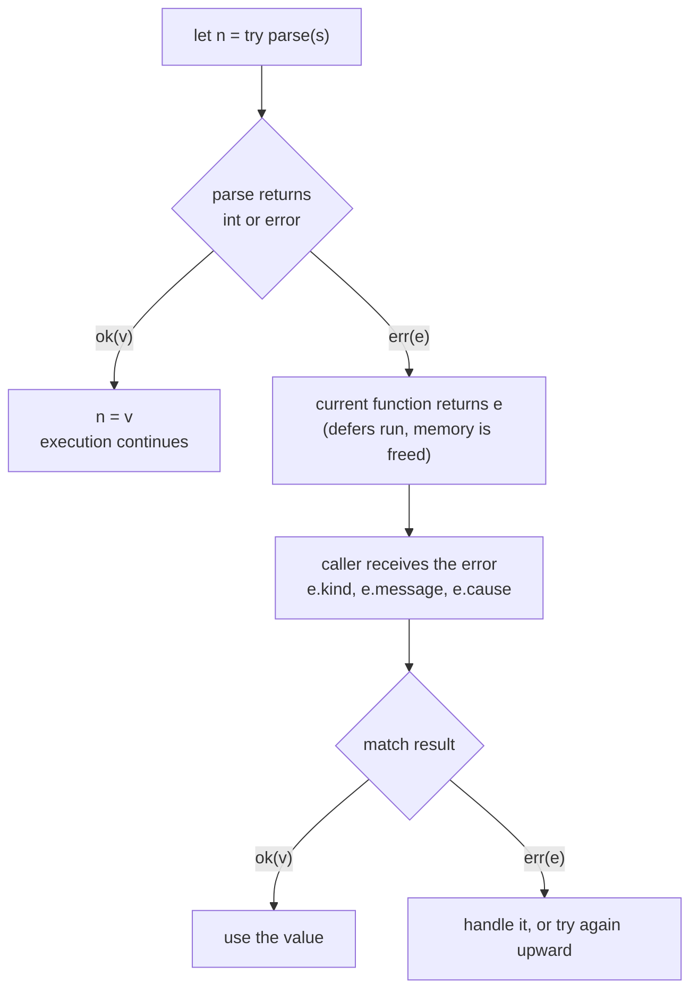
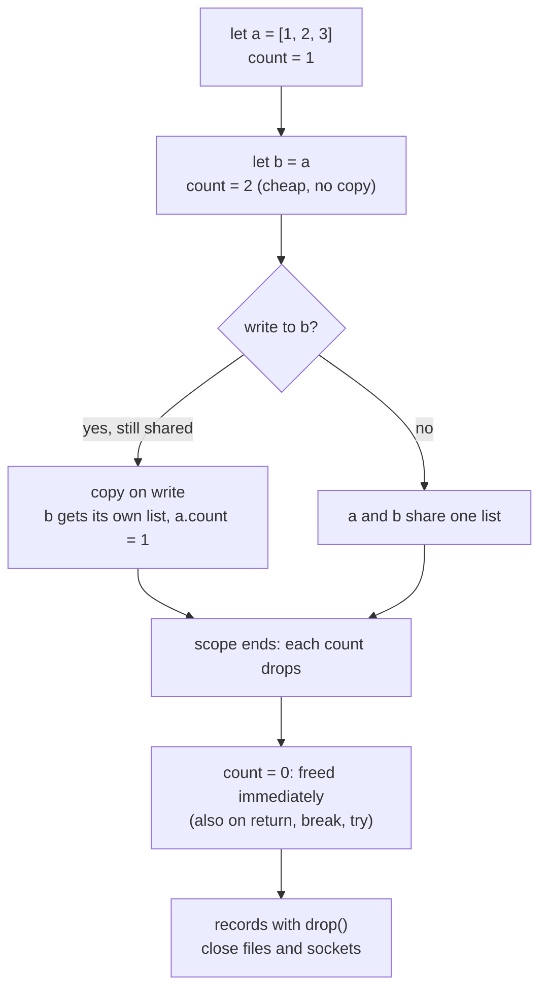
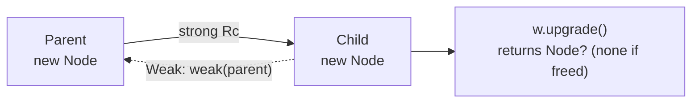
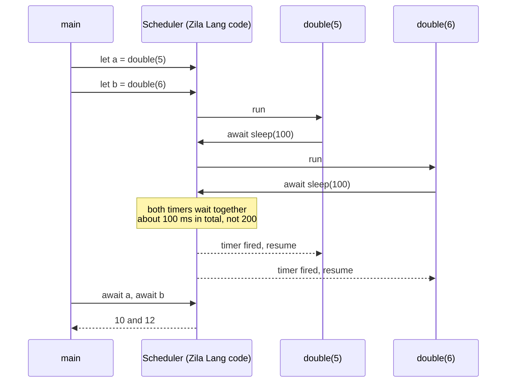
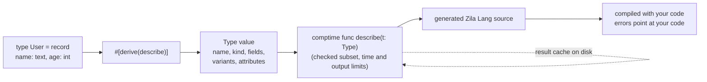
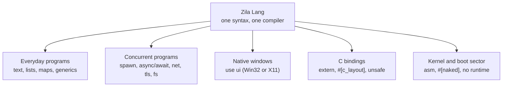

# Zila Lang in diagrams

Diagrams that explain how Zila Lang works (GitHub draws them). They were moved here from the README to keep it short.

## 1. Errors are values

A function that can fail says so in its type. `try` is the one visible place where a failure travels up.

## 2. Memory without a garbage collector

Values are reference counted and freed the instant the last reference goes away. Writes copy first when a value is shared.

A cycle made only of strong `Rc` references is not collected; break it with `Weak`.

## 3. Concurrency: tasks on one scheduler

Tasks are lightweight and cooperative. `await` hands the thread to another task instead of blocking it.

## 4. Compile-time code generation

A `comptime func` is a native program that reads a type and writes Zila Lang source, which the compiler compiles in place.

## 5. One language, from app to metal

